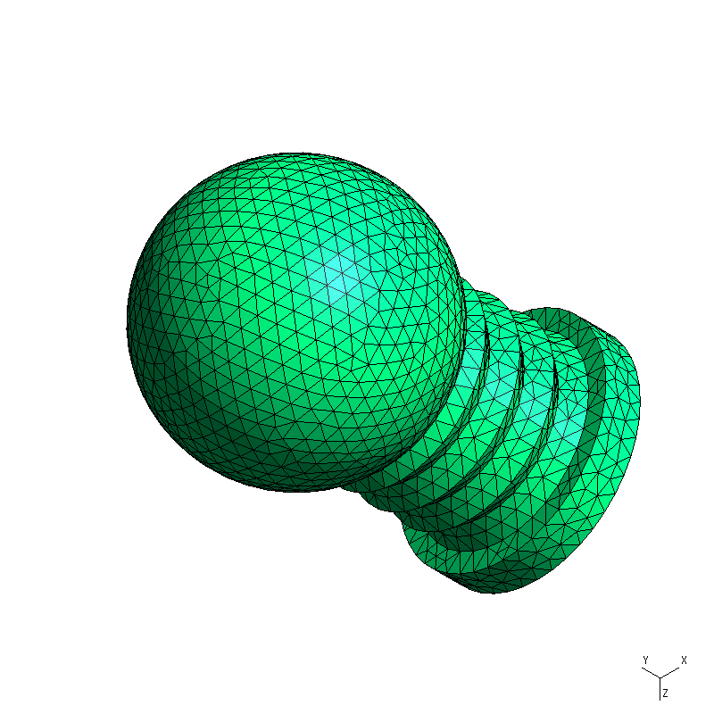
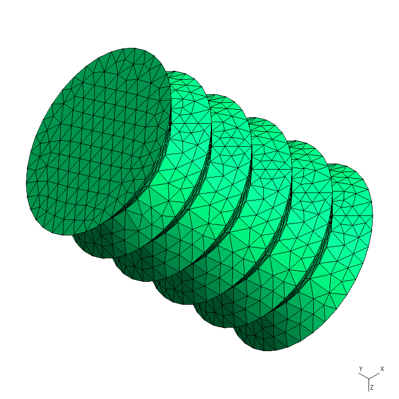
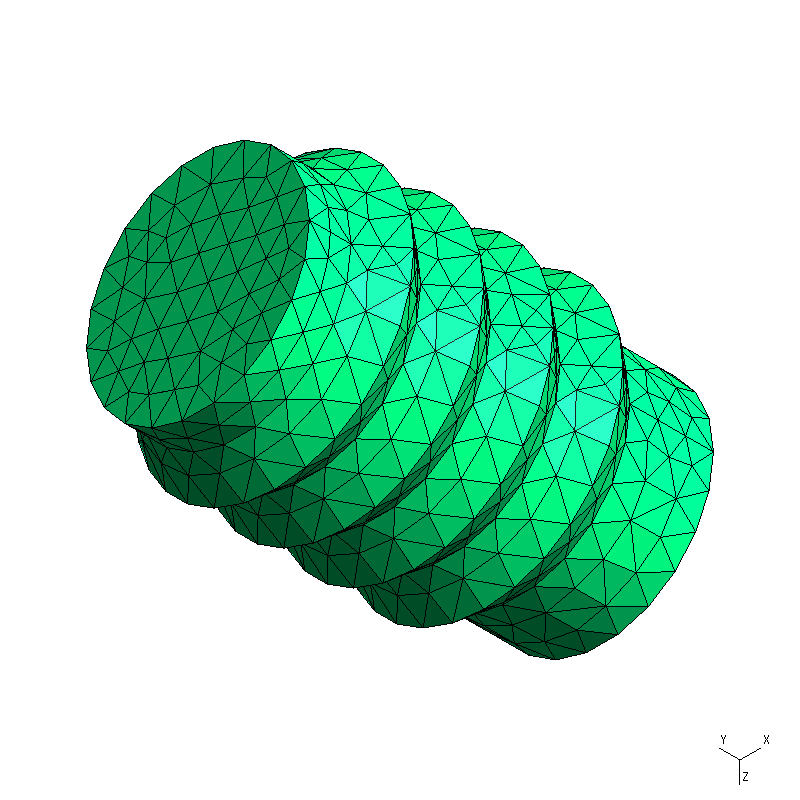
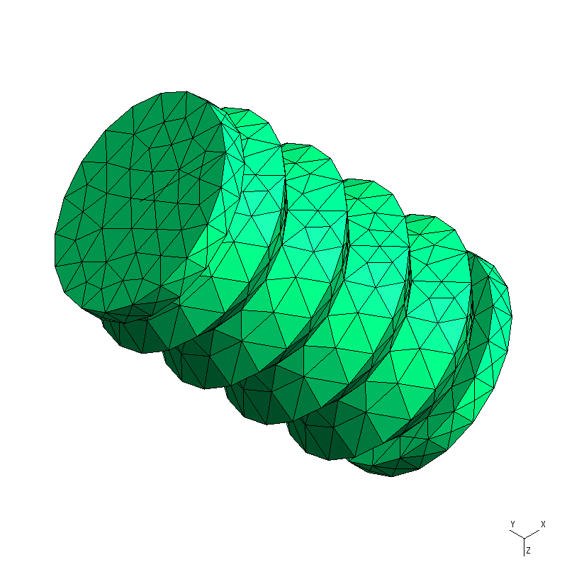
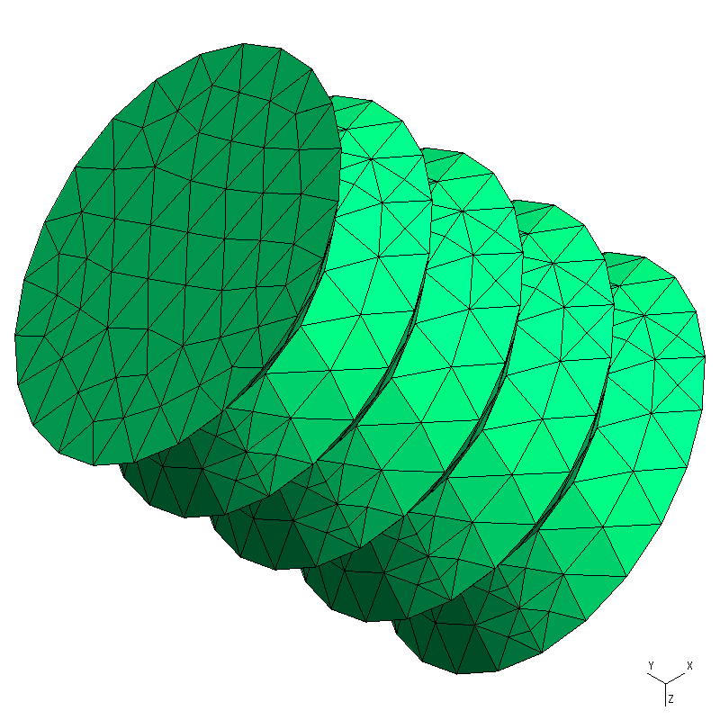

## Benchmark results

Job: `2026-10-07__09-03-00`

| Harness | Model | Reward | Mesh quality | Mesh preview |
| --- | --- | --- | --- | --- |
| oracle | Reference solution | 1 | Volume minDetJac: 4.48 / 47.6 Volume minSICN: 0.273 / 0.808 Surface minSICN: 0.417 / 0.951 Cavity minSICN: 0.0595 / 0.467 |  |
| opencode | openrouter/deepseek/deepseek-v4.1-flash | 1 | Volume minDetJac: 0.211 / 2.72 Volume minSICN: 0.311 / 0.779 Surface minSICN: 0.729 / 0.954 Cavity minSICN: 0.729 / 0.949 |  |
| pi | openai/qwen/qwen3.5-9b | 0 | — | — |
| codex | openai/gpt-6.1-sol | 1 | Volume minDetJac: 1.11 / 10.4 Volume minSICN: 0.202 / 0.742 Surface minSICN: 0.366 / 0.927 Cavity minSICN: 0.366 / 0.909 |  |
| codex | openai/gpt-6-luna | 1 | Volume minDetJac: 2.99 / 15.5 Volume minSICN: 0.3 / 0.808 Surface minSICN: 0.665 / 0.936 Cavity minSICN: 0.845 / 0.965 |  |
| pi | openrouter/deepseek/deepseek-v4.1-flash | 1 | Volume minDetJac: 1.04 / 10.4 Volume minSICN: 0.346 / 0.764 Surface minSICN: 0.662 / 0.912 Cavity minSICN: 0.863 / 0.971 |  |

Mesh quality values are **minimum / mean**, from Gmsh. These diagnostics do not change the reward. Missing results appear as `—`.
